<a href="https://nur-as-sunnah.com"></a>

<p align="center">
  <a href="#features">Возможности&nbsp;›</a>&emsp;
  <a href="#stack">Стек&nbsp;›</a>&emsp;
  <a href="#run">Запуск&nbsp;›</a>&emsp;
  <a href="#structure">Структура&nbsp;›</a>&emsp;
  <a href="#contact">Связаться&nbsp;›</a>
</p>

<br>

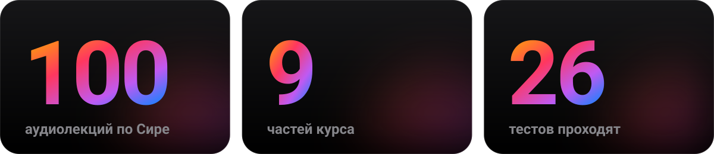

<br>
<br>


<br>
<br>

<a name="features"></a>


<a href="https://nur-as-sunnah.com">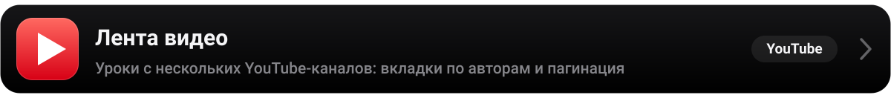</a>
<a href="main/search.py"></a>
<a href="main/sira_data.py">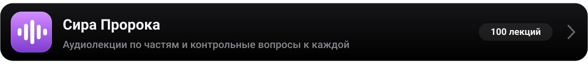</a>
<a href="vercel.json">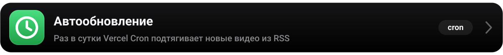</a>
<a href="main/admin.py">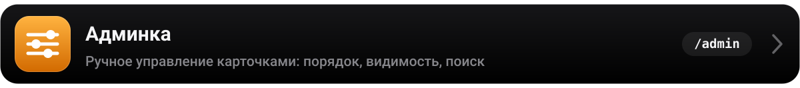</a>

<br>
<br>

<a name="stack"></a>


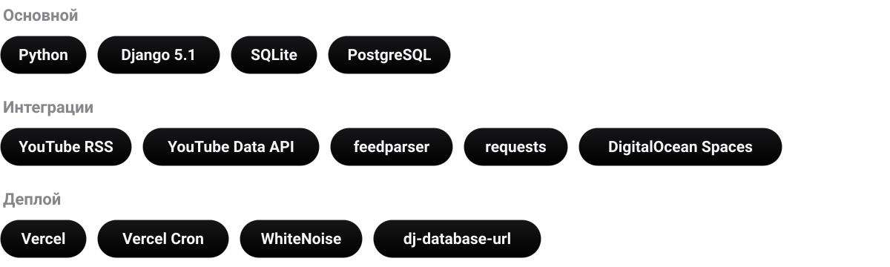

<br>
<br>

<a name="run"></a>
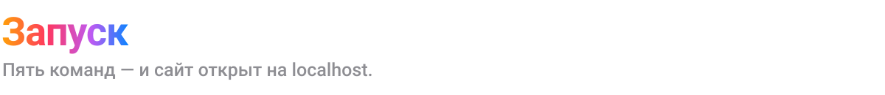

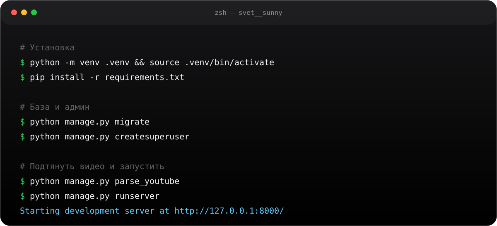

<details>
<summary>Скопировать команды</summary>
<br>

```bash
python -m venv .venv && source .venv/bin/activate
pip install -r requirements.txt

cp .env.example .env        # заполните значения
python manage.py migrate
python manage.py createsuperuser

python manage.py parse_youtube
python manage.py runserver
```

Сайт — на http://127.0.0.1:8000, админка — на `/admin/`.

**Команды загрузки видео**

| Команда | Что делает |
| --- | --- |
| `parse_youtube` | Последние видео каналов из RSS, без API-ключа. Её же запускает cron. |
| `parse_youtube_full [--channel ID]` | Все видео канала через YouTube Data API v3. |
| `update_durations` | Дописывает длительность карточкам, у которых её нет. |

**Тесты**

```bash
DATABASE_URL=sqlite:///:memory: python manage.py test main
```

**Пересобрать картинки README**

```bash
python3 scripts/build_readme_assets.py
```

</details>

<details>
<summary>Переменные окружения</summary>
<br>

| Переменная | Назначение |
| --- | --- |
| `DJANGO_SECRET_KEY` | Секретный ключ. Обязателен на Vercel. |
| `DJANGO_DEBUG` | `1` — включить отладку локально. |
| `DATABASE_URL` | Строка подключения к БД. Без неё используется SQLite. |
| `YOUTUBE_CHANNEL_IDS` | ID каналов через запятую. |
| `YOUTUBE_API_KEY` | Ключ YouTube Data API. |
| `CRON_SECRET` | Секрет для `/api/cron/parse-youtube/`. |
| `AWS_ACCESS_KEY_ID`, `AWS_SECRET_ACCESS_KEY` | Доступ к хранилищу медиа (DigitalOcean Spaces). |

</details>

<br>
<br>

<a name="structure"></a>


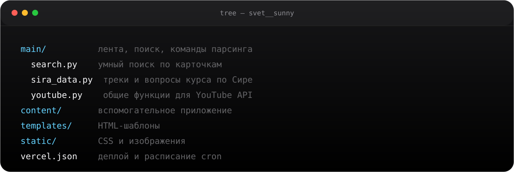

<br>
<br>

<a name="contact"></a>


<p>
<a href="https://t.me/svettsunny"></a><a href="https://youtube.com/@abdurtwhd"></a><a href="https://www.instagram.com/abdurtwhd"></a>
</p>

<br>


<p align="center">
  <sub>Проект не нуждается в финансировании — достаточно поделиться ссылкой с близкими.</sub>
</p>
