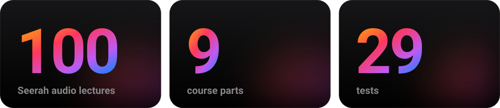
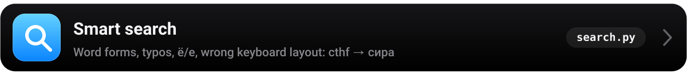
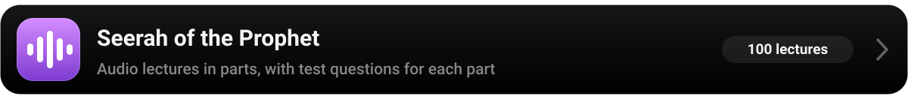
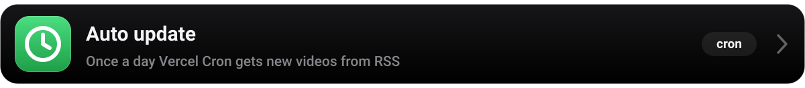
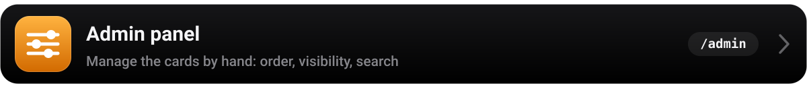
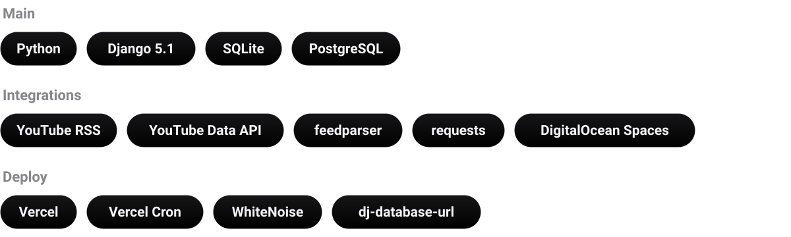

<b>English</b> &nbsp;|&nbsp; <a href="README.ru.md">Русский</a>

  <a href="#features">Features&nbsp;›</a>&emsp;
  <a href="#stack">Stack&nbsp;›</a>&emsp;
  <a href="#contact">Contact&nbsp;›</a>

 

 
 

 
 

 
 

 

  The project does not need money — just share the link with your family and friends.

